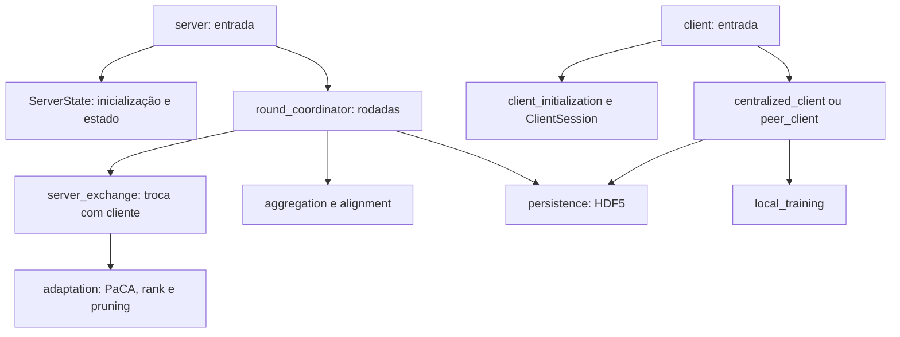

# AGENTS.md — FL_ServerPuma

## Escopo e leitura inicial

Estas instruções se aplicam a todo o repositório. Este arquivo é a referência central de desenvolvimento, arquitetura e responsabilidades. O [sumário de dependências e funções](docs/sumario-dependencias.md) complementa este guia com a navegação hierárquica do código. O [README](README.md) apresenta os cenários de execução.

Antes de editar, leia as regras abaixo, consulte o módulo afetado no inventário e no sumário e confira seus consumidores com `rg`. O código e os arquivos presentes devem ser conferidos: inventários, resultados e registros de validação têm data e não comprovam o estado de uma execução futura. Instruções explícitas do usuário prevalecem sobre convenções deste guia.

## Contexto e prioridades

FL_ServerPuma é um projeto de pesquisa acadêmica em aprendizado federado, com experimentos centralizados e descentralizados/P2P, incluindo mobilidade veicular no SUMO. Trabalha com CNN, CLIP e SLM, FedAvg/FedALA, adaptadores LoRA/AdaLoRA/SoRA, PaCA, rank adaptativo, poda e compressão LHDQ.

O objetivo é permitir entender, reproduzir e modificar os experimentos com pouco código. A arquitetura é modular, orientada às responsabilidades reais da pesquisa. Não aplicar DDD rígido nem criar camadas para mudanças hipotéticas de requisitos. Reprodutibilidade, clareza e preservação do comportamento científico têm prioridade sobre generalizações e redução artificial da contagem de linhas.

Stack: Python 3.11, PyTorch/torchvision, Transformers/PEFT, NumPy, HDF5/h5py, pandas, matplotlib/seaborn, YAML, TCP, Docker Compose e SUMO/TraCI. `pyproject.toml` define dependências e empacotamento Hatchling; `uv.lock` fixa a resolução usada por uv. `requirements.txt` é uma alternativa legada e diverge dessas versões. Não trocar o gerenciador nem atualizar dependências como efeito colateral de uma refatoração.

## Regras para novas funções e alterações

1. **Procure reuso antes de escrever.** Busque pelo comportamento e pelos nomes relacionados no código e no sumário. Reutilize a função existente quando seu contrato atender ao caso. Antes de alterar uma função compartilhada, encontre todos os consumidores e preserve os casos já suportados.
2. **Uma responsabilidade por função e por módulo.** A função deve ter um objetivo que caiba em uma frase. Separe cálculo científico, transporte, persistência, preparação de dados e apresentação. Um coordenador pode chamar essas operações, mas não deve incorporar suas implementações.
3. **Coloque a função no módulo que já é dono do assunto.** Use a tabela de localização deste guia. Crie um arquivo somente quando houver uma responsabilidade distinta. Não acrescente funções a `server.py` ou `client.py` só porque esses arquivos iniciam a execução.
4. **Escolha a menor implementação legível que resolve o caso atual.** Prefira funções diretas, biblioteca padrão e dependências já instaladas. Remova duplicações e código comprovadamente morto no escopo da alteração. Não comprima várias operações em uma linha, não esconda condições em expressões difíceis e não crie uma função para cada linha.
5. **Não crie abstrações especulativas.** Evite classes-base, fábricas, interfaces Strategy, camadas de serviços/repositórios, wrappers, aliases e opções de configuração sem um consumidor concreto. Classes são úteis quando realmente guardam estado ou implementam um modelo/otimizador, como já ocorre no projeto.
6. **Reuso exige equivalência de comportamento.** A semelhança entre CLIP e SLM não basta para unificar suas implementações. Preserve diferenças de shapes, dtype, dispositivo, collator, precisão, acumulação de gradientes e adaptadores. Extraia um trecho comum apenas quando o contrato compartilhado estiver claro e verificado.
7. **Dependências e efeitos devem ser claros.** Passe os dados necessários; não use estado global mutável para conectar módulos. Preserve a identidade de modelo/listas em `ServerState` e `ClientSession`, os locks, eventos e mutações das políticas. Não substitua referências por cópias silenciosamente.
8. **Preserve validações, erros e contratos.** Código menor não justifica retirar verificações, tratamento de falhas ou informação necessária para interpretar um experimento. Use nomes descritivos; adicione tipos e docstrings quando esclarecem entrada, saída, unidades ou efeitos.
9. **Conclua a mudança em todos os consumidores.** Atualize imports, CLIs, scripts, Docker/Compose, configurações e notebook quando forem afetados. Não recrie arquivos de compatibilidade para esconder imports antigos.
10. **Toda nova função deve constar no sumário na mesma alteração.** A regra inclui funções públicas, privadas, assíncronas, auxiliares aninhadas e métodos escritos no projeto. Renomear, mover ou excluir uma função também exige atualizar sua referência. O procedimento está na próxima seção.

Não há um limite arbitrário de linhas: se uma função ou arquivo cresce porque passou a acumular responsabilidades, divida por assunto. Não transfira um bloco grande para um arquivo genérico apenas para reduzir o tamanho do arquivo original. Não ampliar `utils.py`, `helpers.py` ou `fl_math.py` com assuntos sem relação com sua responsabilidade atual.

### Concordância com a arquitetura

- `algorithms/`: cálculos de agregação, alinhamento, personalização, poda e políticas adaptativas. Novos cálculos não devem importar pontos de entrada, abrir sockets, gravar HDF5 ou gerar gráficos.
- `models/`: redes, adaptadores, treino específico da família e medidas do modelo. Não importar coordenadores de execução para reutilizar uma função; mova-a para seu módulo responsável quando necessário.
- `data/`: leitura, particionamento e loaders; preparação específica de CLIP/SLM permanece em `models/<família>/data.py`.
- `communication/`: protocolo e trocas. `server_exchange.py` é o adaptador que conecta a troca com um cliente às políticas existentes; `tcp.py` deve continuar dedicado ao transporte.
- `persistence/`: formatos, nomes, atributos e gravação dos resultados. Recebe métricas calculadas em outros módulos.
- `execution/`: composição e sequência do experimento, estado, rodadas e fluxos centralizado/P2P. Os arquivos de entrada continuam pequenos.
- `experiments/analysis/`: leitura de resultados, métricas comparativas e gráficos; não deve ser uma dependência do núcleo de treinamento.
- `simulation/`: integração Docker/SUMO, mobilidade, sinais e rotas; não deve hospedar algoritmos de treinamento.

Essas são orientações para alterações futuras, não uma afirmação de que todas as dependências existentes já seguem uma arquitetura estritamente em camadas. Não introduzir ciclos de importação. Módulos compartilhados ficam no local responsável pelo comportamento, acessível aos consumidores, em vez de importações reversas de um ponto de entrada.

## Atualização obrigatória do sumário

Arquivo: [docs/sumario-dependencias.md](docs/sumario-dependencias.md).

1. Localize a primeira ocorrência expandida do arquivo dono da função na árvore. A numeração `1 → 1.1 → 1.1.1` representa imports entre arquivos, não chamadas de funções.
2. Na linha **Funções/métodos**, registre o nome exato e qualificado: `aggregate_models`, `ModelTrainer.execute_epochs` ou `run_decentralized.wait_for_encounter`. O link do arquivo na seção identifica sua origem; não use números de linha como identificador permanente.
3. Para um arquivo novo, adicione sua responsabilidade e seus imports internos sob o consumidor correspondente. Se não tiver consumidores internos, crie um capítulo próprio. Referências repetidas apontam para a primeira expansão; uma dependência nova deve aparecer em cada arquivo que a importa.
4. Atualize as entradas após renomeações, remoções e movimentos. Inclua imports locais/condicionais; confira também funções nas células de código de notebooks e funções de scripts quando forem criadas. Para notebooks, identifique a célula se houver nomes repetidos.
5. Confira links, âncoras, numeração, indentação e cobertura. Atualize contagens e a data do levantamento quando o conteúdo mudar. As listas de funções não são arestas de dependência nem prova de que a função é usada.
6. Quando mudar a responsabilidade ou localização de um arquivo, atualize também o inventário deste `AGENTS.md`, o cabeçalho do código e os comandos do README que forem afetados.

Exemplo de registro sob o arquivo responsável, usando um nome ilustrativo:

```text
1.2 algorithms/aggregation.py — Agrega as atualizações dos clientes.
    Funções/métodos: aggregate_models, nova_funcao.
    1.2.1 algorithms/alignment.py — Alinha os parâmetros locais ao estado global.
```

Não considerar a implementação concluída se uma nova função não estiver referenciada no sumário. Não é necessário criar uma ferramenta ou framework de documentação para cumprir a regra: conferir os nomes e imports com AST/`rg` é suficiente.

## Estilo e preservação científica

- **Todo arquivo novo não vazio deve ter um comentário curto no topo, em português, explicando sua função e responsabilidade.** A regra inclui código, scripts e configurações; cite as principais funções/classes quando ajudar a compreensão. Use a sintaxe de comentário do formato e mantenha o cabeçalho atualizado quando a responsabilidade mudar.
- Posicione o cabeçalho após shebang, declaração de encoding ou outra diretiva que precise ocupar a primeira linha. Em notebooks, use uma célula Markdown inicial. Para formatos que não aceitam comentários ou arquivos binários, registre a explicação no inventário deste guia, sem invalidar o arquivo.
- **Não adicione comentários aos `__init__.py`**; mantenha-os vazios, sem reexportações ou inicialização operacional. Arquivos vazios não precisam de cabeçalho.
- Preserve avisos de licença e autoria, shebang e declarações de encoding. Comentários internos devem explicar decisões, unidades, invariantes e razões científicas; evite narrar cada instrução.
- Siga o estilo local e o Ruff configurado em `pyproject.toml` (Python 3.11, limite de 99 colunas). Evite reformatação de arquivos alheios ao trabalho.
- Em reorganizações, preserve fórmulas, critérios, limites, cooldowns, seeds, ordem das operações, pesos da agregação, máscaras e tratamento de parâmetros não cobertos.
- Preserve nomes/chaves e formas dos `state_dict`, dtype/dispositivo, `requires_grad`, decoradores `torch.no_grad()`, configuração dos otimizadores, `train()`/`eval()` e fronteiras de gradiente PaCA. Não alterar a ordem de sorteios nem adicionar cópias de modelos como efeito colateral.
- Preserve protocolos TCP, sequência de mensagens, medição de bytes/tempo, sincronização, nomes de datasets HDF5, atributos, unidades e caminhos de saída. Métricas com o mesmo nome devem continuar representando a mesma quantidade.
- Confira a semântica dos flags nos consumidores. Há convenções invertidas, como `--ala 0` para FedALA e `--ala 1` para FedAvg; defaults e ajuda podem diferir entre servidor, cliente e script. Não padronizar flags incidentalmente.
- Se o pedido for apenas estrutural, não alterar o comportamento científico nem corrigir um problema algorítmico sem tornar essa mudança parte explícita do escopo. Registre limitações encontradas com precisão; não afirme que um ramo foi validado apenas porque o módulo importa.
- Dados, partições, checkpoints, resultados e logs são artefatos de pesquisa. Use diretórios temporários ou um nome de experimento próprio nas verificações. Não sobrescreva resultados de referência nem execute rotinas de limpeza como checagem.

## Fluxo de trabalho e validação

1. Inspecione `git status`, o código afetado, seus imports/consumidores e os recursos necessários. Preserve alterações locais e arquivos removidos pelo usuário; não restaure itens históricos só porque aparecem neste guia.
2. Identifique o contrato que precisa permanecer igual e o menor conjunto de módulos a alterar. Para uma função nova, busque reuso e escolha seu dono antes de implementá-la.
3. Faça a mudança, ajuste os consumidores e atualize sumário, cabeçalhos e inventário quando necessário.
4. Valide proporcionalmente ao risco. Para uma alteração documental, confira nomes e links. Para extração de código, compare a estrutura/comportamento antes e depois, compile e exercite os caminhos afetados. Para lógica científica nova ou corrigida, faça uma verificação pequena e significativa com dados sintéticos e seeds controladas, incluindo casos de limite relevantes.
5. Informe o que mudou, o que foi executado e o que não foi verificado. Não apresente compilação, `--help` ou construção do wheel como evidência de equivalência experimental completa. Não faça commits, publicação ou limpeza de artefatos como parte implícita de uma tarefa documental.

Comandos de verificação, conforme o ambiente e a alteração:

```bash
# Compilação sintática; não executa o treinamento.
uv run python -m compileall -q src/fl_serverpuma

# Sintaxe dos scripts, sem executá-los.
bash -n src/system/run.sh
bash -n src/system/run_all_sora.sh
bash -n docker/build-optimized.sh
bash -n docker/runclient.sh

git diff --check
```

Se `.venv/bin/python` já estiver disponível, ele pode ser usado nas verificações locais sem sincronizar dependências. Não instalar um linter ou modificar dependências apenas para uma mudança documental. Os comandos `uv sync`/`uv run` podem resolver dependências; os caminhos CLIP/SLM podem precisar de modelos em cache. Não desativar o modo offline silenciosamente para fazer uma checagem passar.

Evite importar todos os módulos como verificação: `get_mean_std.py` lê a entrada padrão ao importar e `update_notebook.py` edita um notebook. `result_utils.py` também oferece exclusão explícita de arquivos. `docker/build-optimized.sh` e `docker/runclient.sh` executam limpeza destrutiva, incluindo remoção de imagens/volumes; não são validadores seguros. Docker/SUMO e treinamentos completos só devem ser executados quando pertinentes ao pedido e com ambiente/recursos identificados.


## Arquitetura e execução atuais

Implementações em `src/fl_serverpuma`, com imports e comandos diretos do pacote.

```text
src/fl_serverpuma/
├── algorithms/       # Agregação, alinhamento, políticas adaptativas, ALA e poda
├── communication/    # TCP, compressão LHDQ e troca com cada cliente
├── data/             # Leitura, particionamento e geradores de datasets
├── execution/        # Entradas, estado e coordenação centralizada/P2P
├── models/           # CNN, CLIP, SLM e medidas de complexidade/tamanho
├── experiments/      # Análises, estatísticas e gráficos
├── persistence/      # Resultados HDF5 do servidor e dos clientes
├── simulation/       # Geração Compose e integração SUMO
└── paths.py          # Base explícita para dados e recursos
```

### Divisão das responsabilidades

`execution/server.py` lê os argumentos e inicia os experimentos.
`server_state.py` inicializa modelo, dados, locks e históricos.
`round_coordinator.py` mantém a sequência das rodadas, delegando as trocas com
clientes a `communication/server_exchange.py`, a agregação a
`algorithms/aggregation.py` e a gravação a `persistence/server_results.py`.

A agregação recebe os estados, pesos, dispositivo e máscaras explicitamente.
O alinhamento de tensores fica em `algorithms/alignment.py`. As decisões de
latência, PaCA, rank e taxa de poda ficam em `algorithms/adaptation/` e recebem
o estado da execução, preservando suas atualizações de histórico.

`execution/client.py` inicializa uma `ClientSession` e escolhe entre
`centralized_client.py` e `peer_client.py`. Carga de dados, treinamento local,
mapeamento de parâmetros e persistência têm módulos próprios. A sessão mantém
referências aos mesmos objetos; a extração não copia modelos nem listas de métricas.



Cada família CLIP/SLM separa configuração, dados, construção do modelo, adaptação
PaCA/SoRA, otimizadores, treino e medição. SoRA separa camadas, poda e otimização
dos gates. As implementações específicas de cada família foram preservadas.

As análises separam leitura HDF5, cálculo de métricas, estilos e gráficos por
assunto. SUMO separa CLI, loop de simulação, mobilidade/contato, sinais de
sincronização, contêineres, leitura da rede e geração/gravação de rotas.

Essa organização usa funções e estados explícitos adequados ao projeto de
pesquisa, sem introduzir hierarquias de estratégias ou repositórios genéricos.
Os coordenadores continuam contendo as ramificações do fluxo experimental;
essa etapa não redefine os algoritmos nem seu protocolo.

### Execução

O fluxo local com uv instala o pacote do projeto e usa execução por módulo:

```bash
# Na raiz do projeto:
uv sync
uv run python -m fl_serverpuma.data.generators.generate_MNIST noniid - dir
uv run python -m fl_serverpuma.simulation.docker.compose --clients 2 --dataset MNIST

# Para treinamento, no diretório de trabalho esperado pelos recursos:
cd src/system
uv run python -m fl_serverpuma.execution.server --help
uv run python -m fl_serverpuma.execution.client --help
```

`src/system/run.sh` chama os módulos do servidor, cliente e gerador diretamente.
Dockerfiles e arquivos Compose usam `python -m` e disponibilizam `/app/src` no
`PYTHONPATH`. O empacotamento wheel inclui somente `fl_serverpuma`.

### Recursos que permanecem fora do pacote

- `src/system`: scripts shell, alias de execução, YAMLs CLIP/SLM e notebook.
- `src/dataset`: datasets e recursos LEAF; os geradores ficam no pacote principal.
- `src/sumo_adapter`: mapas e diretório de saída de gráficos.
- `src/results`: resultados dos experimentos.
- `docker`: Dockerfiles, scripts shell e Compose gerados.

Esses diretórios não fornecem mais módulos Python para imports. São preservados
porque contêm recursos reais ou definem o diretório de trabalho dos experimentos.
`paths.SOURCE_ROOT` permite localizar recursos sem simular a existência de arquivos
Python removidos. Caminhos relativos ao diretório de trabalho mantêm sua semântica.

### Compatibilidade e escopo

Nomes antigos de módulos e scripts foram retirados por decisão explícita. Imports
como `from model import SimpleModel` devem usar
`from fl_serverpuma.models.cnn import SimpleModel`. Objetos Python completos
serializados com nomes antigos de classes/módulos podem precisar de migração
externa; os pesos em `state_dict` não dependem desses nomes de classe.

Também foram removidos `legacy_quantization.py`, `legacy_partitioning.py` e
`partitioning_copy.py`, sem consumidores no código atual. As implementações
utilizadas pelos experimentos permanecem em seus módulos principais.

Não foram alteradas equações, hiperparâmetros, flags científicas ou formatos de
resultados. Os antigos módulos agregadores `clip_setup.py`, `slm_setup.py` e
`sora.py` foram removidos; seus consumidores importam diretamente os módulos
responsáveis. Não há aliases de compatibilidade para essas localizações.

### Evidências e limites de validação

As verificações pertinentes cobrem imports, CLIs, caminhos, Compose, sintaxe shell, agregação parcial, roundtrip da CNN, mensagens TCP, decisões adaptativas, formatos HDF5, poda/gradientes SoRA e mobilidade. Para operações numéricas, prefira CPU e dados sintéticos quando forem suficientes; modelos completos, GPU e simulação exigem validação específica.

Na extração anterior, uma comparação pontual com a cópia anterior conferiu 800 decisões/mutações das políticas adaptativas e 40 agregações parciais, com resultados iguais. A inspeção estrutural também conferiu funções extraídas e os dois loops do cliente, normalizando imports e passagem explícita do estado. Este registro histórico não valida alterações futuras nem substitui a reprodução completa dos experimentos.

Limitações conhecidas estão na seção “Limites e manutenção” do inventário abaixo.

## Inventário de responsabilidades

Inventário de referência em 08/11/2026. Caminhos relativos à raiz do projeto, salvo indicação de uma base diferente. Dados/resultados são uma fotografia local e podem mudar entre execuções.

### 1. Estado atual e conteúdo de `src/system`

As 67 entradas Python de compatibilidade foram removidas. Os imports e comandos usam diretamente `fl_serverpuma`. Também foram removidos os dois marcadores de pacotes antigos (`utils` e `sumo_adapter`) e três implementações históricas sem consumidores: `legacy_quantization.py`, `legacy_partitioning.py` e `partitioning_copy.py`.

`src/system` contém somente recursos operacionais e experimentais: **2 scripts shell, 1 alias simbólico, 2 YAMLs e 1 notebook**, sem módulos Python de compatibilidade. O diretório continua como base de trabalho dos fluxos que usam caminhos relativos de dados/configuração.

```text
src/system/run.sh
  → uv run python -m fl_serverpuma.execution.server
  → uv run python -m fl_serverpuma.execution.client
```

Servidor e cliente agora são pontos de entrada pequenos. Inicialização, coordenação, políticas adaptativas, treino, dados e persistência têm módulos próprios. CLIP/SLM, análises e simulação também foram decompostos por responsabilidade.

Comandos com os nomes antigos e imports como `from model import SimpleModel` deixam de ser suportados. Objetos Python completos serializados com referências aos módulos antigos também deixam de ter essa compatibilidade; arquivos de pesos em `state_dict` não dependem desses nomes de classe.

### 2. Escopo do inventário

São listados individualmente os arquivos de código, documentação, configuração e recursos encontrados no projeto, inclusive recursos operacionais e arquivos locais de dados/resultados. Arquivos internos de `.git`, `.venv`, `__pycache__` e `.ipynb_checkpoints` são descritos por categoria, pois são metadados/dependências/cache, e não módulos da aplicação. Diretórios reservados ao ambiente de ferramentas, como `.agents`, `.codex` e `.aws`, não fazem parte deste inventário da aplicação. O inventário é uma fotografia: resultados e caches podem mudar após novas execuções.

### 3. Responsabilidade de cada pasta

| Pasta | Responsabilidade |
| --- | --- |
| `docker/` | Dockerfiles e comandos de preparação/execução; o gerador Compose é chamado pelo pacote principal. |
| `docs/` | Sumário hierárquico dos imports e registro de funções/métodos. Arquitetura e inventário ficam neste AGENTS.md. |
| `src/` | Pacote principal e diretórios de recursos/dados/execução. |
| `src/fl_serverpuma/` | Pacote principal; contém as implementações Python reorganizadas. |
| `src/fl_serverpuma/algorithms/` | Agregação, alinhamento de parâmetros, políticas adaptativas, personalização e poda. |
| `src/fl_serverpuma/algorithms/adaptation/` | Políticas de latência, PaCA, rank e taxa de poda. |
| `src/fl_serverpuma/algorithms/personalization/` | Personalização local ALA e sua variante para adaptadores. |
| `src/fl_serverpuma/algorithms/pruning/` | Implementações de poda estrutural, NISP e SNIP. |
| `src/fl_serverpuma/communication/` | Protocolo TCP e compressão/quantização de estados. |
| `src/fl_serverpuma/data/` | Leitura, preparação, particionamento e utilitários de dados. |
| `src/fl_serverpuma/data/generators/` | Um gerador específico por dataset. |
| `src/fl_serverpuma/execution/` | Pontos de entrada, estados de execução e coordenação de rodadas/treinamento centralizado e P2P. |
| `src/fl_serverpuma/persistence/` | Gravação dos resultados HDF5 do servidor e dos clientes. |
| `src/fl_serverpuma/models/` | CNN, famílias CLIP/SLM e medições de tamanho/complexidade. |
| `src/fl_serverpuma/models/clip/` | Implementação da família CLIP e seus adaptadores. |
| `src/fl_serverpuma/models/slm/` | Implementação da família SLM e seus adaptadores. |
| `src/fl_serverpuma/experiments/` | Código de análise de experimentos; não há runner/config centralizados nesta pasta. |
| `src/fl_serverpuma/experiments/analysis/` | Estatísticas, leitura de resultados, gráficos e manutenção de notebook. |
| `src/fl_serverpuma/simulation/` | Integração com ambientes de execução simulados. |
| `src/fl_serverpuma/simulation/docker/` | Geração de Compose centralizado. |
| `src/fl_serverpuma/simulation/sumo/` | Orquestração V2V, geração de Compose e rotas. |
| `src/system/` | Scripts shell ativos, YAMLs e notebook; segue sendo diretório de trabalho dos experimentos, sem arquivos Python de compatibilidade. |
| `src/system/lora_clip/` | YAML de configuração ativo do CLIP; a implementação está no pacote principal. |
| `src/system/lora_slm/` | YAML de configuração ativo do SLM; a implementação está no pacote principal. |
| `src/system/plot/` | Notebook experimental com imports do pacote principal; análises Python ficam em experiments/analysis. |
| `src/dataset/` | Datasets gerados e seus recursos; os geradores Python ficam em fl_serverpuma/data/generators. |
| `src/dataset/utils/` | Contém os dados LEAF/Shakespeare; os utilitários Python foram removidos deste diretório. |
| `src/sumo_adapter/` | Recursos de mapas/gráficos SUMO; a implementação Python está no pacote principal. |
| `src/sumo_adapter/maps/` | Arquivos reais da malha, rotas e configuração SUMO. |
| `src/sumo_adapter/plot/` | Diretório de saída dos gráficos V2V; a implementação está em experiments/analysis. |
| `src/results/` | Artefatos de resultados gerados por experimentos, separados do código. |
| `src/results/smoke_mnist/` | Resultados locais de uma execução identificada como smoke_mnist. |
| `src/dataset/MNIST/` | Dataset MNIST local e suas partições. |
| `src/dataset/MNIST/rawdata/` | Download/cache dos dados brutos MNIST. |
| `src/dataset/MNIST/rawdata/MNIST/` | Organização de cache do dataset MNIST. |
| `src/dataset/MNIST/rawdata/MNIST/raw/` | Imagens e rótulos IDX, comprimidos e descomprimidos. |
| `src/dataset/MNIST/train/` | Partições de treinamento por cliente. |
| `src/dataset/MNIST/test/` | Partições de teste por cliente. |
| `src/dataset/utils/LEAF/` | Hierarquia dos dados LEAF/Shakespeare usados pelo gerador de texto; preserva o caminho original de leitura. |
| `src/dataset/utils/LEAF/data/` | Hierarquia dos dados LEAF/Shakespeare usados pelo gerador de texto; preserva o caminho original de leitura. |
| `src/dataset/utils/LEAF/data/shakespeare/` | Hierarquia dos dados LEAF/Shakespeare usados pelo gerador de texto; preserva o caminho original de leitura. |
| `src/dataset/utils/LEAF/data/shakespeare/data/` | Hierarquia dos dados LEAF/Shakespeare usados pelo gerador de texto; preserva o caminho original de leitura. |
| `src/dataset/utils/LEAF/data/shakespeare/data/test/` | Hierarquia dos dados LEAF/Shakespeare usados pelo gerador de texto; preserva o caminho original de leitura. |
| `src/dataset/utils/LEAF/data/shakespeare/data/train/` | Hierarquia dos dados LEAF/Shakespeare usados pelo gerador de texto; preserva o caminho original de leitura. |
| `src/results/fl_puma_MNIST_cnn_lora_prune1_ala1_paca12/` | Diretório local de execução/logs do experimento MNIST; atualmente sem arquivos no inventário. |
| `src/results/fl_puma_MNIST_cnn_lora_prune1_ala1_paca12/logs/` | Diretório local de execução/logs do experimento MNIST; atualmente sem arquivos no inventário. |
| `src/results/fl_puma_MNIST_cnn_lora_prune1_ala1_paca12/logs/sim_1/` | Diretório local de execução/logs do experimento MNIST; atualmente sem arquivos no inventário. |

Pastas administradas pelas ferramentas:

| Pasta | Responsabilidade |
| --- | --- |
| `.git/` | Objetos, histórico, referências, índice e configuração local do Git. |
| `.venv/` | Interpretador, executáveis e bibliotecas do ambiente Python; não é código desenvolvido no projeto. |
| `__pycache__/` em qualquer pacote | Bytecode Python gerado automaticamente. |
| `.ipynb_checkpoints/`, quando criado | Cópias automáticas dos notebooks produzidas pelo Jupyter. |

### 4. Implementações do pacote `src/fl_serverpuma`

Cada linha descreve um arquivo atual. Os pontos de entrada delegam trabalho aos módulos de responsabilidade; não há arquivos de reexportação para os caminhos antigos.

#### Raiz do pacote

| Arquivo | Responsabilidade |
| --- | --- |
| `src/fl_serverpuma/__init__.py` | Marca este diretório como pacote Python; não contém lógica operacional. |
| `src/fl_serverpuma/paths.py` | Define SOURCE_ROOT, a base explícita de datasets, resultados e recursos. Não resolve nomes de arquivos Python removidos. |

#### `algorithms/`

| Arquivo | Responsabilidade |
| --- | --- |
| `src/fl_serverpuma/algorithms/__init__.py` | Marca este diretório como pacote Python; não contém lógica operacional. |
| `src/fl_serverpuma/algorithms/aggregation.py` | Agrega estados parciais com pesos por cliente; recebe dispositivo e máscaras explicitamente, sem depender do estado completo do servidor. |
| `src/fl_serverpuma/algorithms/alignment.py` | Alinha tensores locais/podados às dimensões globais e constrói máscaras de cobertura para agregação. |
| `src/fl_serverpuma/algorithms/fl_math.py` | Quantização/desquantização int8, avaliação do modelo, cópia de parâmetros e redimensionamento para estados podados. Ainda reúne operações de naturezas diferentes. |

#### `algorithms/adaptation/`

| Arquivo | Responsabilidade |
| --- | --- |
| `src/fl_serverpuma/algorithms/adaptation/__init__.py` | Marca este diretório como pacote Python; não contém lógica operacional. |
| `src/fl_serverpuma/algorithms/adaptation/latency.py` | Calcula a meta de latência e o timeout amortecido a partir das medições dos clientes. |
| `src/fl_serverpuma/algorithms/adaptation/paca.py` | Decide PaCA por latência, perda e acurácia; aplica cooldown, limites e reversão, atualizando o histórico da política. |
| `src/fl_serverpuma/algorithms/adaptation/pruning.py` | Calcula a taxa de poda usando custo computacional, comunicação e histórico de tempo; inclui fallback. |
| `src/fl_serverpuma/algorithms/adaptation/rank.py` | Decide rank adaptativo por latência, perda e acurácia, preservando limites e histórico. |

#### `algorithms/personalization/`

| Arquivo | Responsabilidade |
| --- | --- |
| `src/fl_serverpuma/algorithms/personalization/__init__.py` | Marca este diretório como pacote Python; não contém lógica operacional. |
| `src/fl_serverpuma/algorithms/personalization/ala.py` | Implementa ALA: adaptação local da combinação entre parâmetros globais e locais usando dados do cliente. |
| `src/fl_serverpuma/algorithms/personalization/ala_lora.py` | Implementa a adaptação local ALA para modelos com adaptadores LoRA. |

#### `algorithms/pruning/`

| Arquivo | Responsabilidade |
| --- | --- |
| `src/fl_serverpuma/algorithms/pruning/__init__.py` | Marca este diretório como pacote Python; não contém lógica operacional. |
| `src/fl_serverpuma/algorithms/pruning/nisp.py` | Calcula importância de neurônios a partir de ativações e aplica a poda da camada totalmente conectada. |
| `src/fl_serverpuma/algorithms/pruning/snip.py` | Calcula máscaras de poda SNIP com gradientes e aplica as máscaras ao modelo. |
| `src/fl_serverpuma/algorithms/pruning/structural.py` | Aplica poda e reestruturação do modelo; mantém funções de restauração de tamanho por máscaras. |

#### `communication/`

| Arquivo | Responsabilidade |
| --- | --- |
| `src/fl_serverpuma/communication/__init__.py` | Marca este diretório como pacote Python; não contém lógica operacional. |
| `src/fl_serverpuma/communication/lhdq.py` | Codifica e decodifica deltas entre estados por quantização e codificação Huffman; identifica payloads LHDQ. |
| `src/fl_serverpuma/communication/server_exchange.py` | Executa a troca de uma rodada com um cliente: prepara o estado a enviar, aplica as políticas e recebe atualização e métricas sob os locks existentes. |
| `src/fl_serverpuma/communication/tcp.py` | Envia e recebe mensagens serializadas com pickle, com cabeçalho de tamanho, leitura completa, timeout e medição de bytes/taxa. |

#### `data/`

| Arquivo | Responsabilidade |
| --- | --- |
| `src/fl_serverpuma/data/__init__.py` | Marca este diretório como pacote Python; não contém lógica operacional. |
| `src/fl_serverpuma/data/client_data.py` | Lê partições locais de treino/teste dos clientes, incluindo tratamento específico de texto e Shakespeare. |
| `src/fl_serverpuma/data/client_loaders.py` | Constrói os DataLoaders locais conforme dataset e família do modelo. |
| `src/fl_serverpuma/data/har.py` | Lê e formata dados de sensores/atividades, separa treino/teste e salva partições para os geradores HAR/PAMAP2. |
| `src/fl_serverpuma/data/language.py` | Converte caracteres, palavras e textos em representações numéricas; reúne tokenização, vocabulário e utilitários de embeddings. |
| `src/fl_serverpuma/data/partitioning.py` | Verifica configurações existentes, distribui dados entre clientes, separa treino/teste e grava partições e metadados; usa Path nos caminhos de persistência. |
| `src/fl_serverpuma/data/server_data.py` | Carrega e prepara os dados de teste globais, incluindo tokenização para SLM. |

#### `data/generators/`

| Arquivo | Responsabilidade |
| --- | --- |
| `src/fl_serverpuma/data/generators/__init__.py` | Marca este diretório como pacote Python; não contém lógica operacional. |
| `src/fl_serverpuma/data/generators/generate_AGNews.py` | Prepara notícias AGNews e gera partições por cliente conforme as opções e regras já existentes no gerador. |
| `src/fl_serverpuma/data/generators/generate_AmazonReview.py` | Prepara avaliações AmazonReview e gera partições por cliente conforme as opções e regras já existentes no gerador. |
| `src/fl_serverpuma/data/generators/generate_Cifar10.py` | Prepara imagens CIFAR-10 e gera partições por cliente conforme as opções e regras já existentes no gerador. |
| `src/fl_serverpuma/data/generators/generate_Cifar100.py` | Prepara imagens CIFAR-100 e gera partições por cliente conforme as opções e regras já existentes no gerador. |
| `src/fl_serverpuma/data/generators/generate_Country211.py` | Prepara imagens Country211 e gera partições por cliente conforme as opções e regras já existentes no gerador. |
| `src/fl_serverpuma/data/generators/generate_DTD.py` | Prepara texturas DTD e gera partições por cliente conforme as opções e regras já existentes no gerador. |
| `src/fl_serverpuma/data/generators/generate_Digit5.py` | Prepara domínios de imagens de dígitos Digit5 e gera partições por cliente conforme as opções e regras já existentes no gerador. |
| `src/fl_serverpuma/data/generators/generate_DomainNet.py` | Prepara imagens de múltiplos domínios DomainNet e gera partições por cliente conforme as opções e regras já existentes no gerador. |
| `src/fl_serverpuma/data/generators/generate_ECG.py` | Prepara sinais ECG a partir de arquivos CSV locais e gera partições por cliente conforme as opções e regras já existentes no gerador. |
| `src/fl_serverpuma/data/generators/generate_EMNIST.py` | Prepara caracteres EMNIST e gera partições por cliente conforme as opções e regras já existentes no gerador. |
| `src/fl_serverpuma/data/generators/generate_FGVCAircraft.py` | Prepara imagens de aeronaves FGVC-Aircraft e gera partições por cliente conforme as opções e regras já existentes no gerador. |
| `src/fl_serverpuma/data/generators/generate_FashionMNIST.py` | Prepara imagens Fashion-MNIST e gera partições por cliente conforme as opções e regras já existentes no gerador. |
| `src/fl_serverpuma/data/generators/generate_Flowers102.py` | Prepara imagens Flowers102 e gera partições por cliente conforme as opções e regras já existentes no gerador. |
| `src/fl_serverpuma/data/generators/generate_GTSRB.py` | Prepara imagens de sinais de trânsito GTSRB e gera partições por cliente conforme as opções e regras já existentes no gerador. |
| `src/fl_serverpuma/data/generators/generate_HAR.py` | Prepara dados de reconhecimento de atividades humanas HAR e gera partições por cliente conforme as opções e regras já existentes no gerador. |
| `src/fl_serverpuma/data/generators/generate_MNIST.py` | Prepara dígitos MNIST e gera partições por cliente conforme as opções e regras já existentes no gerador. |
| `src/fl_serverpuma/data/generators/generate_Omniglot.py` | Prepara caracteres Omniglot e gera partições por cliente conforme as opções e regras já existentes no gerador. |
| `src/fl_serverpuma/data/generators/generate_OxfordPets.py` | Prepara imagens OxfordPets e gera partições por cliente conforme as opções e regras já existentes no gerador. |
| `src/fl_serverpuma/data/generators/generate_PAMAP2.py` | Prepara dados de atividades PAMAP2 e gera partições por cliente conforme as opções e regras já existentes no gerador. |
| `src/fl_serverpuma/data/generators/generate_Shakespeare.py` | Prepara texto Shakespeare e gera partições por cliente conforme as opções e regras já existentes no gerador. |
| `src/fl_serverpuma/data/generators/generate_SogouNews.py` | Prepara notícias SogouNews e gera partições por cliente conforme as opções e regras já existentes no gerador. |
| `src/fl_serverpuma/data/generators/generate_StanfordCars.py` | Prepara imagens StanfordCars e gera partições por cliente conforme as opções e regras já existentes no gerador. |
| `src/fl_serverpuma/data/generators/generate_TinyImagenet.py` | Prepara imagens Tiny ImageNet e gera partições por cliente conforme as opções e regras já existentes no gerador. |

#### `execution/`

| Arquivo | Responsabilidade |
| --- | --- |
| `src/fl_serverpuma/execution/__init__.py` | Marca este diretório como pacote Python; não contém lógica operacional. |
| `src/fl_serverpuma/execution/centralized_client.py` | Executa o ciclo de comunicação, treinamento e avaliação do cliente conectado ao servidor. |
| `src/fl_serverpuma/execution/client.py` | Ponto de entrada do cliente: cria a sessão e seleciona o fluxo centralizado ou P2P. |
| `src/fl_serverpuma/execution/client_cli.py` | Define os argumentos e valores padrão da CLI do cliente. |
| `src/fl_serverpuma/execution/client_initialization.py` | Seleciona dispositivo/PaCA, constrói modelo e dados, configura ALA e entrega a sessão pronta. |
| `src/fl_serverpuma/execution/client_session.py` | Agrupa modelo, dados, configuração e listas de métricas de um cliente, sem copiar seus objetos. |
| `src/fl_serverpuma/execution/local_training.py` | Executa uma etapa local de treino e personalização e seleciona os pesos retornados ao servidor. |
| `src/fl_serverpuma/execution/peer_client.py` | Executa treinamento descentralizado, listener P2P e reação aos sinais de encontros, mantendo a sincronização original. |
| `src/fl_serverpuma/execution/round_coordinator.py` | Coordena conexões e rodadas, dispara trocas por cliente, chama agregação, avaliação e persistência e mantém a sequência do experimento. |
| `src/fl_serverpuma/execution/server.py` | Ponto de entrada do servidor: lê a CLI, seleciona dispositivo e inicia os experimentos. |
| `src/fl_serverpuma/execution/server_cli.py` | Define os argumentos e valores padrão da CLI do servidor. |
| `src/fl_serverpuma/execution/server_state.py` | Inicializa o modelo global e guarda configuração, conexões, locks, dados e históricos de uma execução em ServerState. |

#### `experiments/`

| Arquivo | Responsabilidade |
| --- | --- |
| `src/fl_serverpuma/experiments/__init__.py` | Marca este diretório como pacote Python; não contém lógica operacional. |

#### `experiments/analysis/`

| Arquivo | Responsabilidade |
| --- | --- |
| `src/fl_serverpuma/experiments/analysis/__init__.py` | Marca este diretório como pacote Python; não contém lógica operacional. |
| `src/fl_serverpuma/experiments/analysis/accuracy_plots.py` | Gera gráficos de acurácia global, perda de treinamento e comparação entre acurácia local de teste e de treino. |
| `src/fl_serverpuma/experiments/analysis/analise_estrategias.py` | CLI e apresentação dos resumos comparativos entre estratégias. |
| `src/fl_serverpuma/experiments/analysis/analise_tempo.py` | Lê logs dos experimentos, extrai durações de rodadas e compara tempos médios de execução. |
| `src/fl_serverpuma/experiments/analysis/analyze_sora_vs_lora.py` | Carrega métricas de acurácia, perda e parâmetros para comparar os resultados de SoRA e LoRA. |
| `src/fl_serverpuma/experiments/analysis/communication_plots.py` | Gera gráficos do volume de dados transferido por rodada, acumulado e em função do tempo. |
| `src/fl_serverpuma/experiments/analysis/efficiency_plots.py` | Relaciona acurácia, comunicação e tempo para visualizar eficiência. |
| `src/fl_serverpuma/experiments/analysis/exchange_time.py` | Lê registros de eventos V2V e gera análise/gráficos dos tempos de troca. |
| `src/fl_serverpuma/experiments/analysis/get_mean_std.py` | Lê o nome de um arquivo .out da entrada padrão e calcula média/desvio de acurácias. Executa esse processamento ao importar o módulo. |
| `src/fl_serverpuma/experiments/analysis/model_plots.py` | Gera gráficos do tamanho dos adaptadores, quantidade de parâmetros treináveis e evolução do PaCA. |
| `src/fl_serverpuma/experiments/analysis/plot_results.py` | Seleciona experimentos, carrega resultados e coordena a geração dos gráficos. |
| `src/fl_serverpuma/experiments/analysis/plot_style.py` | Centraliza estilos, opções de apresentação, seleção de experimentos e salvamento das figuras. |
| `src/fl_serverpuma/experiments/analysis/result_loading.py` | Interpreta nomes de experimentos, lê HDF5 de servidor/clientes e prepara séries de comunicação e tempos. |
| `src/fl_serverpuma/experiments/analysis/result_utils.py` | Lê resultados HDF5 de várias execuções e calcula estatísticas; inclui opção explícita de remover o arquivo lido. |
| `src/fl_serverpuma/experiments/analysis/strategy_metrics.py` | Carrega resultados por execução, detecta convergência e calcula estatísticas e melhorias entre estratégias. |
| `src/fl_serverpuma/experiments/analysis/strategy_settings.py` | Define experimentos, janela de convergência e limiares da comparação. |
| `src/fl_serverpuma/experiments/analysis/timing_plots.py` | Gera gráficos de duração das rodadas, treino, comunicação, processamento e avaliação. |
| `src/fl_serverpuma/experiments/analysis/update_notebook.py` | Edita referências e padrões de arquivos dentro de plot_results.ipynb no diretório de trabalho. Executa a edição ao importar; esse notebook-alvo não está presente no inventário atual. |
| `src/fl_serverpuma/experiments/analysis/v2v_accuracy.py` | Carrega resultados dos clientes V2V e produz gráficos de acurácia individual, pós-P2P e comparações. |

#### `models/`

| Arquivo | Responsabilidade |
| --- | --- |
| `src/fl_serverpuma/models/__init__.py` | Marca este diretório como pacote Python; não contém lógica operacional. |
| `src/fl_serverpuma/models/cnn.py` | Define SimpleModel: CNN com duas etapas convolucionais e camadas totalmente conectadas para classificação. |
| `src/fl_serverpuma/models/complexity.py` | Calcula complexidade por camada e medidas SynExp por meio de LayerComplexityCalculator e SynExpSimple. |
| `src/fl_serverpuma/models/flops.py` | Conta ou estima FLOPs de um modelo para determinada entrada. |
| `src/fl_serverpuma/models/size.py` | Mede tamanho total/treinável, quantidade de parâmetros e tamanho de tensores de um state_dict. |
| `src/fl_serverpuma/models/state_mapping.py` | Mapeia chaves de estados sequenciais para os nomes de parâmetros de SimpleModel. |

#### `models/clip/`

| Arquivo | Responsabilidade |
| --- | --- |
| `src/fl_serverpuma/models/clip/__init__.py` | Marca este diretório como pacote Python; não contém lógica operacional. |
| `src/fl_serverpuma/models/clip/adaptation.py` | Aplica SoRA e controla as camadas/gradientes habilitados por PaCA em tempo de execução. Família CLIP. |
| `src/fl_serverpuma/models/clip/clip_sora_utils.py` | Reduz o rank de matrizes SoRA no state_dict de CLIP, preservando a lógica específica dessa família. |
| `src/fl_serverpuma/models/clip/config.py` | Lê YAML/CLI, resolve modos de execução e monta configurações e caminhos de saída. Família CLIP. |
| `src/fl_serverpuma/models/clip/data.py` | Define collator, codificação de rótulos e construção dos DataLoaders. Família CLIP. |
| `src/fl_serverpuma/models/clip/main.py` | Executa o pipeline independente de CLIP: configuração, dados, construção, treinamento, poda, avaliação e exportação. |
| `src/fl_serverpuma/models/clip/measurement.py` | Executa benchmark de inferência e quantiza pesos para exportação. Família CLIP. |
| `src/fl_serverpuma/models/clip/model.py` | Define o classificador e constrói o modelo com os adaptadores selecionados. Família CLIP. |
| `src/fl_serverpuma/models/clip/optimization.py` | Constrói otimizadores e scheduler conforme o modo de adaptação. Família CLIP. |
| `src/fl_serverpuma/models/clip/sora_layers.py` | Define as camadas SoRALinear e SoRAWrappedLinear e sua propagação direta. Família CLIP. |
| `src/fl_serverpuma/models/clip/sora_optimization.py` | Implementa SparseAdamW e GateSparsifier para atualizar e esparsificar gates. Família CLIP. |
| `src/fl_serverpuma/models/clip/sora_pruning.py` | Compacta o rank SoRA, converte para LoRA, ajusta congelamento e extrai parâmetros treináveis. Família CLIP. |
| `src/fl_serverpuma/models/clip/trainer.py` | Coordena épocas e fases de treinamento de CLIP, impressão de métricas, benchmark de inferência e finalização. |
| `src/fl_serverpuma/models/clip/training.py` | Executa uma época de treino, mede esparsidade e avalia o classificador. Família CLIP. |

#### `models/slm/`

| Arquivo | Responsabilidade |
| --- | --- |
| `src/fl_serverpuma/models/slm/__init__.py` | Marca este diretório como pacote Python; não contém lógica operacional. |
| `src/fl_serverpuma/models/slm/adaptation.py` | Aplica SoRA e controla as camadas/gradientes habilitados por PaCA em tempo de execução. Família SLM. |
| `src/fl_serverpuma/models/slm/config.py` | Lê YAML/CLI, resolve modos de execução e monta configurações e caminhos de saída. Família SLM. |
| `src/fl_serverpuma/models/slm/data.py` | Define collator, codificação de rótulos e construção dos DataLoaders. Família SLM. |
| `src/fl_serverpuma/models/slm/main.py` | Executa o pipeline independente de SLM: configuração, dados, construção, treinamento, poda, avaliação e exportação. |
| `src/fl_serverpuma/models/slm/measurement.py` | Quantiza pesos para exportação; benchmark_attention permanece sem implementação, como na versão anterior. Família SLM. |
| `src/fl_serverpuma/models/slm/model.py` | Define o classificador e constrói o modelo com os adaptadores selecionados. Família SLM. |
| `src/fl_serverpuma/models/slm/optimization.py` | Constrói otimizadores e scheduler conforme o modo de adaptação. Família SLM. |
| `src/fl_serverpuma/models/slm/slm_sora_utils.py` | Reduz o rank de matrizes SoRA no state_dict de SLM, preservando a lógica específica dessa família. |
| `src/fl_serverpuma/models/slm/sora_layers.py` | Define as camadas SoRALinear e SoRAWrappedLinear e sua propagação direta. Família SLM. |
| `src/fl_serverpuma/models/slm/sora_optimization.py` | Implementa SparseAdamW e GateSparsifier para atualizar e esparsificar gates. Família SLM. |
| `src/fl_serverpuma/models/slm/sora_pruning.py` | Compacta o rank SoRA, converte para LoRA, ajusta congelamento e extrai parâmetros treináveis. Família SLM. |
| `src/fl_serverpuma/models/slm/trainer.py` | Coordena épocas e fases de treinamento de SLM, impressão de métricas, benchmark de inferência e finalização. |
| `src/fl_serverpuma/models/slm/training.py` | Executa uma época de treino, mede esparsidade e avalia o classificador. Família SLM. |

#### `persistence/`

| Arquivo | Responsabilidade |
| --- | --- |
| `src/fl_serverpuma/persistence/__init__.py` | Marca este diretório como pacote Python; não contém lógica operacional. |
| `src/fl_serverpuma/persistence/client_results.py` | Grava métricas locais/globais e opcionais de P2P em HDF5, preservando nomes de arquivos e atributos. |
| `src/fl_serverpuma/persistence/server_results.py` | Grava métricas e metadados do servidor em HDF5 com os nomes e caminhos originais. |

#### `simulation/`

| Arquivo | Responsabilidade |
| --- | --- |
| `src/fl_serverpuma/simulation/__init__.py` | Marca este diretório como pacote Python; não contém lógica operacional. |

#### `simulation/docker/`

| Arquivo | Responsabilidade |
| --- | --- |
| `src/fl_serverpuma/simulation/docker/__init__.py` | Marca este diretório como pacote Python; não contém lógica operacional. |
| `src/fl_serverpuma/simulation/docker/compose.py` | Gera o Docker Compose do experimento centralizado, com servidor, clientes, parâmetros, rede e volumes. |

#### `simulation/sumo/`

| Arquivo | Responsabilidade |
| --- | --- |
| `src/fl_serverpuma/simulation/sumo/__init__.py` | Marca este diretório como pacote Python; não contém lógica operacional. |
| `src/fl_serverpuma/simulation/sumo/compose.py` | Gera o Docker Compose dos clientes V2V. Quando executado diretamente, apenas orienta usar o orquestrador. |
| `src/fl_serverpuma/simulation/sumo/containers.py` | Inicia e encerra os contêineres do experimento por Docker Compose. |
| `src/fl_serverpuma/simulation/sumo/create_trips.py` | CLI de geração de viagens; seleciona rede/opções e coordena geração e gravação das rotas. |
| `src/fl_serverpuma/simulation/sumo/mobility.py` | Define VehicleState/V2VEvent e calcula distâncias, tempo de contato e agrupamentos de veículos. |
| `src/fl_serverpuma/simulation/sumo/network.py` | Lê a rede SUMO e extrai arestas/conexões e seus metadados. |
| `src/fl_serverpuma/simulation/sumo/orchestrator.py` | CLI do orquestrador SUMO; valida opções e inicia o loop de simulação. |
| `src/fl_serverpuma/simulation/sumo/route_files.py` | Grava rotas XML e atualiza o arquivo de configuração SUMO. |
| `src/fl_serverpuma/simulation/sumo/route_settings.py` | Centraliza os padrões e caminhos de geração de rotas. |
| `src/fl_serverpuma/simulation/sumo/routing.py` | Gera trajetos válidos e estima os tempos de percurso/simulação. |
| `src/fl_serverpuma/simulation/sumo/settings.py` | Centraliza caminhos, constantes e configuração de log da orquestração V2V. |
| `src/fl_serverpuma/simulation/sumo/signals.py` | Escreve sinais atômicos de encontros e aguarda marcadores de conclusão de épocas dos clientes. |
| `src/fl_serverpuma/simulation/sumo/simulation_loop.py` | Avança a simulação TraCI e coordena encontros, sincronização, contêineres e registros de eventos. |

### 5. Execução direta do pacote

Todos os comandos Python usam `uv run python -m fl_serverpuma.<módulo>`. Os Dockerfiles e os Compose usam `python -m` com `PYTHONPATH=/app/src`. O wheel contém somente `fl_serverpuma`.

| Operação | Comando |
| --- | --- |
| Servidor, a partir de `src/system` | `uv run python -m fl_serverpuma.execution.server` |
| Cliente, a partir de `src/system` | `uv run python -m fl_serverpuma.execution.client` |
| Preparar MNIST | `uv run python -m fl_serverpuma.data.generators.generate_MNIST noniid - dir` |
| Gerar Compose centralizado | `uv run python -m fl_serverpuma.simulation.docker.compose` |
| Orquestrar SUMO, a partir de `src/sumo_adapter` | `uv run python -m fl_serverpuma.simulation.sumo.orchestrator --sumo-cfg maps/grid.sumocfg` |
| Análise de estratégias | `uv run python -m fl_serverpuma.experiments.analysis.analise_estrategias` |

Os diretórios de trabalho e argumentos específicos de cada experimento continuam relevantes. Os dados, resultados, mapas, YAMLs e scripts shell permanecem nos locais indicados abaixo.

### 6. Arquivos operacionais, documentação, configuração e dados

| Arquivo | Responsabilidade |
| --- | --- |
| `.dockerignore` | Define o que é excluído do contexto enviado ao build Docker. |
| `.gitignore` | Define arquivos e artefatos ignorados pelo Git, incluindo dados, resultados e padrões de YAML/mapas. |
| `README.md` | Apresentação do projeto, requisitos, comandos de execução e referência à organização do código. |
| `docker/build-optimized.sh` | Limpa recursos Docker, faz build sem cache, gera Compose e inicia serviços. Contém down -v --rmi all e docker system prune -a -f; não é apenas um script de build. |
| `docker/dockerfile.client` | Constrói o ambiente do cliente em múltiplos estágios; prepara dados_compartilhados e inicia python -m fl_serverpuma.execution.client em /app/src/system. |
| `docker/dockerfile.server` | Constrói o ambiente do servidor em múltiplos estágios; inicia python -m fl_serverpuma.execution.server em /app/src/system. |
| `docker/runclient.sh` | Script legado de limpeza e inicialização usando docker-composeclient.yml. Também remove recursos Docker; o YAML citado não está presente no inventário atual. |
| `AGENTS.md` | Instruções de desenvolvimento, visão geral da arquitetura, execução, inventário de responsabilidades e limites. |
| `docs/sumario-dependencias.md` | Dependências indentadas e numeradas, responsabilidades e referências às funções/métodos de cada arquivo. |
| `pyproject.toml` | Metadados, dependências Python, configuração Ruff/uv, backend de build e seleção dos pacotes incluídos no wheel. |
| `requirements.txt` | Lista alternativa/legada de dependências. Difere do pyproject.toml, inclusive no requisito de torch; não é o arquivo utilizado por uv sync nos Dockerfiles. |
| `src/dataset/MNIST/config.json` | Metadados da geração/particionamento MNIST existente. |
| `src/dataset/MNIST/rawdata/MNIST/raw/t10k-images-idx3-ubyte` | Imagens MNIST de teste, em formato IDX descomprimido. |
| `src/dataset/MNIST/rawdata/MNIST/raw/t10k-images-idx3-ubyte.gz` | Imagens MNIST de teste, em formato IDX comprimido com gzip. |
| `src/dataset/MNIST/rawdata/MNIST/raw/t10k-labels-idx1-ubyte` | Rótulos MNIST de teste, em formato IDX descomprimido. |
| `src/dataset/MNIST/rawdata/MNIST/raw/t10k-labels-idx1-ubyte.gz` | Rótulos MNIST de teste, em formato IDX comprimido com gzip. |
| `src/dataset/MNIST/rawdata/MNIST/raw/train-images-idx3-ubyte` | Imagens MNIST de treino, em formato IDX descomprimido. |
| `src/dataset/MNIST/rawdata/MNIST/raw/train-images-idx3-ubyte.gz` | Imagens MNIST de treino, em formato IDX comprimido com gzip. |
| `src/dataset/MNIST/rawdata/MNIST/raw/train-labels-idx1-ubyte` | Rótulos MNIST de treino, em formato IDX descomprimido. |
| `src/dataset/MNIST/rawdata/MNIST/raw/train-labels-idx1-ubyte.gz` | Rótulos MNIST de treino, em formato IDX comprimido com gzip. |
| `src/dataset/MNIST/test/0.npz` | Partição de teste MNIST do cliente 0. |
| `src/dataset/MNIST/test/1.npz` | Partição de teste MNIST do cliente 1. |
| `src/dataset/MNIST/train/0.npz` | Partição de treinamento MNIST do cliente 0. |
| `src/dataset/MNIST/train/1.npz` | Partição de treinamento MNIST do cliente 1. |
| `src/dataset/utils/LEAF/data/shakespeare/data/test/all_data_niid_2_keep_0_test_9.json` | Dados LEAF/Shakespeare de teste em JSON, consumidos pelo gerador de partições de texto. |
| `src/dataset/utils/LEAF/data/shakespeare/data/train/all_data_niid_2_keep_0_train_9.json` | Dados LEAF/Shakespeare de treino em JSON, consumidos pelo gerador de partições de texto. |
| `src/results/smoke_mnist/server_MNIST_lora_rank8_paca12_withou_Prune_freq0_FedALA_run1.h5` | Artefato HDF5 de métricas do servidor da execução smoke_mnist; resultado gerado, não implementação. |
| `src/sumo_adapter/maps/grid.net.xml` | Descrição da rede viária SUMO. |
| `src/sumo_adapter/maps/grid.rou.xml` | Rotas e demanda de veículos da simulação SUMO. |
| `src/sumo_adapter/maps/grid.sumocfg` | Configuração SUMO que referencia os arquivos de rede/rotas e parâmetros da simulação. |
| `src/system/lora_clip/train_config.yml` | Configuração ativa do experimento CLIP: modelo/dataset, LoRA/AdaLoRA/SoRA/PaCA, treinamento, otimizador, scheduler e saída. |
| `src/system/lora_slm/train_config.yml` | Configuração ativa do experimento SLM/Qwen: modelo/dataset, adaptadores, PaCA, treinamento, otimizador, scheduler e saída. |
| `src/system/plot/flopsxpercentage.ipynb` | Notebook exploratório que compara FLOPs e tamanho serializado sob diferentes percentuais de poda OPALA/NISP/SNIP. Seus imports usam fl_serverpuma; as células científicas foram preservadas e não foram executadas integralmente. |
| `src/system/run.sh` | Orquestrador shell ativo: processa argumentos, cria sessões/janelas tmux, executa servidor/clientes e controla sequências de simulações e logs. |
| `src/system/run_all_pumagt.sh` | Link simbólico para run_all_sora.sh; oferece um nome alternativo para o mesmo orquestrador PUMA-GT, sem uma segunda implementação. |
| `src/system/run_all_sora.sh` | Orquestrador shell ativo de uma sequência PUMA-GT/SoRA nos datasets OxfordPets, DTD, FGVCAircraft e Flowers102, chamando run.sh. |
| `uv.lock` | Resolução travada das dependências usada pelo fluxo uv e pelos Dockerfiles. |

O inventário inclui YAMLs, mapas e artefatos locais. Alguns desses caminhos podem ser ignorados por padrões do `.gitignore`; confirme com `git status`/`git check-ignore` quando necessário. Presença local e versionamento são coisas diferentes.

### 7. Onde alterar cada responsabilidade hoje

| Necessidade | Local |
| --- | --- |
| Mudar agregação ou alinhamento | `algorithms/aggregation.py` e `algorithms/alignment.py`. |
| Mudar decisões adaptativas | `algorithms/adaptation/`. |
| Mudar operações de poda ou ALA | `algorithms/pruning/` e `algorithms/personalization/`. |
| Mudar a sequência de rodadas | `execution/round_coordinator.py`. |
| Mudar uma troca servidor/cliente | `communication/server_exchange.py`. |
| Mudar treinamento local | `execution/local_training.py`. |
| Mudar fluxo centralizado ou P2P | `execution/centralized_client.py` e `execution/peer_client.py`. |
| Mudar preparação de modelo/adaptadores | `models/clip/` ou `models/slm/`, conforme a responsabilidade descrita acima. |
| Mudar protocolo ou compressão | `communication/tcp.py` e `communication/lhdq.py`. |
| Mudar dados | `data/` ou `models/<família>/data.py`. |
| Mudar gravação HDF5 | `persistence/`. |
| Mudar gráficos ou estatísticas | `experiments/analysis/`, nos módulos de leitura, métricas ou gráficos. |
| Mudar cálculo de encontros | `simulation/sumo/mobility.py`. |
| Mudar sincronização V2V | `simulation/sumo/signals.py` e `simulation/sumo/simulation_loop.py`. |
| Mudar geração de rotas | `simulation/sumo/routing.py`, `network.py` ou `route_files.py`. |

Os caminhos desta seção são relativos a `src/fl_serverpuma`. Parâmetros YAML e scripts tmux continuam em `src/system`.

### 8. Limites e manutenção

A divisão segue as responsabilidades atuais da pesquisa. `ServerState` e `ClientSession` guardam referências e históricos compartilhados; não representam um modelo DDD. Políticas adaptativas mantêm as mutações anteriores nesses históricos. Os coordenadores ainda contêm os loops e as ramificações necessários à execução dos experimentos.

Foram preservados equações, opções CLI, formatos de mensagens, nomes de métricas e caminhos dos resultados. Verificações de comandos, caminhos, Compose, shell, agregação, políticas adaptativas, HDF5, SoRA e contratos TCP não substituem treinamentos completos, execução Docker/SUMO nem validação integral do notebook.

A inspeção também identificou uma limitação anterior: o ramo P2P de CLIP/SLM importa `set_trainable_state_dict`, mas essa função já não existia nas implementações anteriores de SoRA. A refatoração não implementa essa funcionalidade ausente; esse ramo continua precisando de uma correção própria.
